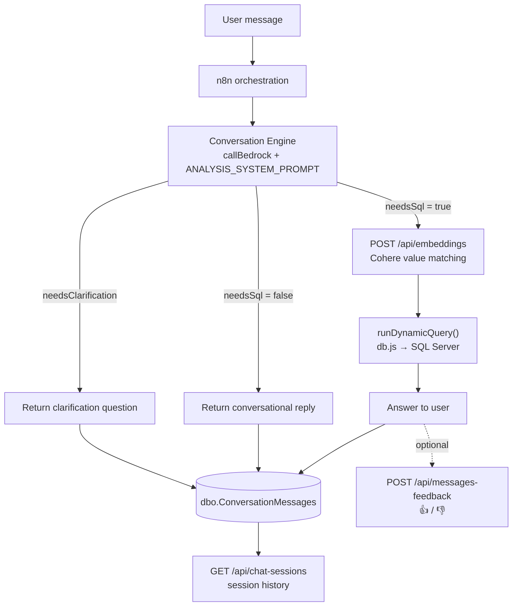

This page traces the end-to-end lifecycle of a single chat message inside `ai-chat-server`: how it arrives, how the Conversation Intelligence Engine interprets it, how it turns into a database query, and where every turn is stored. Reach for it when you need a mental model of who calls whom before diving into any one route or service.

## What this is and the problem it solves

The chat server answers **business questions with real data**. A user asks something in natural language ("how were sales last week?"), and the system must decide whether the question needs a database query, resolve any missing context (like a time range), run SQL against the business's SQL Server, and return an answer — while persisting every turn for history and feedback.

The hard part is the middle: a raw user message is rarely a ready-to-run query. It may be a vague follow-up, it may omit a required time range, or it may be pure conversation. The **Conversation Intelligence Engine** (`services/conversationEngine.js`) exists to bridge that gap — it enriches the message into a structured intent before any SQL runs.

## How it works end to end

The server exposes small, focused HTTP routes; an external **n8n** workflow orchestrates them into a pipeline. n8n calls the engine to analyze a message, calls `/api/embeddings` to match query terms against known database values, executes the resulting SQL through the DB service, and records each turn back into `ConversationMessages`.

### 1. Intake and authorization

Every history and feedback request is gated by the `authenticateUser` middleware, mounted with `router.use(authenticateUser)` on `chatSessions.js` and `messagesFeedback.js`. The authenticated `req.user` carries a `userId` and an `isHibizUser` flag.

Authorization is ownership-based: a non-admin may only read their own data. In `chatSessions.js`, a request for another user's `platformUserId` is rejected with `403 Forbidden` unless `isAdmin(req.user)` is true (`user.isHibizUser === 1 || user.isHibizUser === true`). When no `platformUserId` is supplied, the route defaults to the caller's own `req.user.userId`.

### 2. Enrichment — turning a message into an intent

The engine calls Amazon Bedrock (`callBedrock`) with the `ANALYSIS_SYSTEM_PROMPT` and five inputs: the current message, business context, current conversation state, a conversation summary, and the last few messages. It returns a structured decision rather than a final answer. The most important fields:

| Field | Meaning |
|-------|---------|
| `needsSql` | Whether the message requires a database query. **Defaults to `true` when in doubt** — data retrieval is the norm, not the exception. |
| `needsClarification` | Set `true` only when a *required* parameter (e.g. a time range) cannot be resolved from the message, state, summary, or recent messages. Takes absolute priority over the "when in doubt → SQL" rule. |
| `clarificationQuestion` / `missingContext` | A one-sentence question in the user's language, plus which parameter is missing (`time_range` \| `entity` \| `scope`). |
| `state` | Extracted context (`data_scope`, `metric`, `aggregation`, `filters`, `time_context`, …), carried forward across turns. |
| `enhancedMessage` | A resolved, standalone query built after a clarification is answered. |

Two rules matter most in practice. First, **"today" is never a default** — the date context exists only to resolve time expressions the user actually said; if no time is mentioned anywhere, the engine must ask. Second, follow-ups inherit context: when `state.time_context` is already set or `is_refinement` is true, no clarification is needed.

<Note>
The engine computes a **date context** once per day per locale (`he` → Asia/Jerusalem, `en` → America/New_York) via `getDateContext`. Results are cached in `_dateCache` keyed on the locale and today's `YYYY-MM-DD` string, so week/month/last-7-days ranges are stable for the whole day. This context is fed to the LLM to *resolve* stated time expressions, not to invent them.
</Note>

### 3. Value matching with embeddings

When the user's query term must map to a concrete database value (e.g. a store or product name), n8n calls `POST /api/embeddings` (`embeddings.js`). The route validates that `texts` is a non-empty array and that `input_type` is one of `search_query` or `search_document`, then delegates to `embedTexts` (Cohere multilingual embeddings). The caller compares the returned vectors to find the closest known DB values before building the query.

### 4. Processing — running the query

Data retrieval flows through `runDynamicQuery` in `services/db.js`, which runs either AI-generated SQL or a prepared statement against the PROD connection pool. Its behavior:

- **`rawSQL`** — if provided, it is executed as-is (this is the path for AI-generated or prepared queries).
- **`query` object** — otherwise a `SELECT * FROM dbo.<collection> WHERE …` is built from key/value pairs (defaulting to `WHERE 1=1`), with `collection` defaulting to `Transactions`.
- **Parameter binding** — every `@Param` referenced in `queryParams` is bound; `clientId` is injected as `ClientId` if not already present.
- **Missing-parameter safety net** — a regex scans the SQL for `@Name` tokens and **binds any unreferenced parameter to `NULL`** (with a warning) so the query never fails on an unbound variable.

Empty results return `{ message: 'No results found.', collection }`. The connection layer uses a **single lazily-created PROD pool** (`connectToDatabase`) against AWS RDS SQL Server (`encrypt: true`, `trustServerCertificate: true`, 120s `requestTimeout` for long report queries), with a parallel `getDevPool` for the DEV database.

### 5. Storage and history

Every turn is persisted in `dbo.ConversationMessages`, keyed by `SessionId`, `PlatformUserId`, `Role` (`'user'` and the assistant role), `Message`, and `CreatedAt`. The read routes in `chatSessions.js` reconstruct history from this table:

- `GET /api/chat-sessions` groups messages by `SessionId`, returning each session's `StartedAt` (`MIN(CreatedAt)`), `LastAt` (`MAX(CreatedAt)`), and a `Preview` (the first `user` message), ordered by most recent activity.
- `GET /api/chat-sessions/:sessionId/messages` returns the full ordered transcript for one session, scoped to both `sessionId` and `platformUserId`.

Separately, `POST /api/messages-feedback` (`messagesFeedback.js`) records thumbs-up/down feedback into `dbo.MessagesUserFeedback`, requiring `platformUserId` and `feedback` and storing the associated `question`, `answer`, `questionTime`, and free-text `feedbackMessage` with a `GETDATE()` timestamp.

## Key design decisions and trade-offs

- **Enrichment is a distinct stage from retrieval.** Separating "what does the user mean?" (Bedrock analysis) from "run the query" (SQL) lets vague follow-ups and clarification loops be handled without touching the database, and keeps the engine "fully isolated from `services/openai.js` and any legacy chat code."
- **Bias toward answering with data.** `needsSql` defaults to `true`, so the system errs on the side of querying — except when a required parameter is genuinely missing, where `needsClarification` wins outright. This trades an occasional clarifying question for avoiding fabricated defaults.
- **n8n as the orchestrator.** The server ships small single-purpose routes/services rather than one monolithic endpoint; the sequencing (analyze → match values → query → store) lives in an external n8n workflow. This keeps each piece independently testable at the cost of the flow being defined outside this repo.
- **NULL-binding safety net.** Auto-binding unreferenced `@params` to `NULL` makes AI-generated SQL more robust against dropped parameters, at the risk of silently returning empty results instead of erroring — hence the logged warning.
- **Per-day, per-locale date cache.** Caching date context avoids recomputing stable ranges on every message while keeping Hebrew/English week conventions (Sunday vs. Monday start) correct.

## Where it lives in the code

| Concern | File |
|---------|------|
| Message interpretation, state, date context | `services/conversationEngine.js` |
| DB connection pools, dynamic/prepared query execution | `services/db.js` (`runDynamicQuery`, `connectToDatabase`) |
| Session history read model | `routes/chatSessions.js` |
| Value-matching embeddings | `routes/embeddings.js` |
| User feedback capture | `routes/messagesFeedback.js` |
| Request authentication | `middleware/authenticateUser` |

For the query-building details and the tables behind reports (`Stores`, `WorkSchedule`, `Kpi`), start in `services/db.js`; for how a message is scored into an intent, read the `ANALYSIS_SYSTEM_PROMPT` and `getDateContext` in `services/conversationEngine.js`.