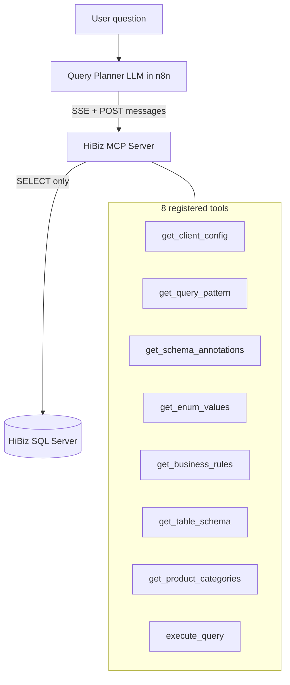

The HiBiz MCP server is a Node.js/TypeScript [Model Context Protocol](https://modelcontextprotocol.io) server that turns a static SQL knowledge base into **8 callable tools** an LLM can query on demand. It exists to solve one problem: a Query Planner LLM in n8n needs deep, client-specific knowledge about the database — enum values, join traps, business rules, ready-made SQL patterns — but stuffing all of that into one static prompt on every request is expensive and goes stale. Instead, the model calls tools to fetch exactly the context it needs, when it needs it.

Reach for this page when you want to understand how the server is built, how tools are registered, and how the pieces of business context fit together into a self-correcting SQL agent loop.

## What it is and the problem it solves

The knowledge the LLM needs lives in five database tables — client config, business rules, enum values, schema annotations, and query patterns. Rather than serialize all of it into one prompt, the server wraps each slice of knowledge in a tool. The Query Planner agent then follows a mandatory workflow: fetch config, pick a query pattern, check annotations and enums, apply business rules, verify columns, build SQL, and run it. Each tool is a small, focused, read-only lookup that scopes every result to a single `ClientId`.

The result is a **retrieval-on-demand** design: the model pulls just-in-time context and self-corrects against real SQL Server errors, instead of one-shotting a query from a frozen prompt.

| Knowledge table | Exposed by tool | Answers |
|---|---|---|
| `McpClientConfig` | `get_client_config` | Timezone, currency, store IDs, language, domain |
| `McpBusinessRules` | `get_business_rules` | Rules + SQL snippets, filtered by `DataScope` |
| `McpEnumValues` | `get_enum_values` | Exact DB enum values (never guess them) |
| `McpSchemaAnnotations` | `get_schema_annotations` | Gotchas invisible to `INFORMATION_SCHEMA` |
| `McpQueryPatterns` | `get_query_pattern` | Ready-to-use SQL templates + critical notes |
| `dbo.Products` (live) | `get_product_categories` | Live category hierarchy |
| `INFORMATION_SCHEMA.COLUMNS` (live) | `get_table_schema` | Live column list to verify names |
| — (runtime) | `execute_query` | Runs the final SELECT, returns rows + count |

## How it works end to end

The server boots by constructing an `McpServer`, registering all 8 tools into it, and exposing them over HTTP so an n8n **MCP Client** node can connect. Transport is SSE: n8n opens a stream to `GET /sse`, reads a `sessionId` from it, and posts tool calls to `POST /messages?sessionId=<id>`. A `GET /health` endpoint returns `{ status: "ok", tools: 8 }`.



Once connected, the agent follows a fixed order. Each step is a tool call whose result narrows what the next step needs to know.

<Steps>
  <Step title="Get client config">
    `get_client_config(clientId)` — always first. Returns timezone, store IDs, and language required before any query.
  </Step>
  <Step title="Pick a query pattern">
    `get_query_pattern(clientId)` — omit `patternName` to list all patterns. The agent always starts from a pattern, never SQL from scratch.
  </Step>
  <Step title="Check annotations and enums">
    `get_schema_annotations(clientId, tableName)` per table, then `get_enum_values(clientId, enumName)` per enum column — reveals join traps and exact DB values.
  </Step>
  <Step title="Apply business rules and verify columns">
    `get_business_rules(clientId, dataScope)` for each relevant scope, then `get_table_schema(clientId, tableName)` to confirm column names exist.
  </Step>
  <Step title="Build and run">
    Assemble SQL from the pattern base plus rules and annotations, then call `execute_query(clientId, sql)`.
  </Step>
</Steps>

### The self-correcting agent loop

`execute_query` is what turns generation from one-shot into a feedback loop. It returns either `{ rows, rowCount }` or `{ error, rows: [], rowCount: 0 }` — and the agent reacts to each outcome:

- **SQL error** → read the returned SQL Server message, fix the SQL, retry (max 3 attempts).
- **Suspicious result** (e.g. revenue = 0 on a busy day) → call `get_business_rules(clientId, "validation")`, compare against sanity thresholds, then fix or flag the anomaly to the user.
- **Valid result** → format and return the answer.

## How a tool is registered

Every tool lives in its own file under `src/tools/` and exports a single `register…(server: McpServer): void` function. That function calls `server.tool(name, description, schema, handler)` — registering the tool's LLM-facing name, its natural-language description, a [Zod](https://zod.dev) parameter schema, and an async handler. Registration is wired up centrally: `createMcpServer()` in `src/index.ts` imports and calls each `register…` function, and `TOOL_COUNT` tracks the total.

The eight registration functions are:

| Function | Tool name |
|---|---|
| `registerClientConfig` | `get_client_config` |
| `registerBusinessRules` | `get_business_rules` |
| `registerEnumValues` | `get_enum_values` |
| `registerSchemaAnnotations` | `get_schema_annotations` |
| `registerTableSchema` | `get_table_schema` |
| `registerProductCategories` | `get_product_categories` |
| `registerQueryPattern` | `get_query_pattern` |
| `registerExecuteQuery` | `execute_query` |

The handler follows a consistent shape: acquire the shared pool with `getPool()`, bind inputs as typed parameters (`.input("clientId", sql.Int, clientId)`), run a parameterized query, and return the recordset as JSON text content. Errors are caught and returned as `{ error: msg }` text rather than thrown, so the LLM always receives a readable response it can act on.

```typescript
export function registerBusinessRules(server: McpServer): void {
  server.tool(
    "get_business_rules",
    `Get rules the model must apply when building queries. ...`,
    {
      clientId: z.number().int().describe("The client ID"),
      dataScope: z.string().optional().describe("Filter by scope (optional)."),
    },
    async ({ clientId, dataScope }) => {
      try {
        const pool = await getPool();
        const req = pool.request().input("clientId", sql.Int, clientId);
        const whereParts = ["ClientId = @clientId", "IsActive = 1"];
        if (dataScope) {
          req.input("dataScope", sql.NVarChar(50), dataScope);
          whereParts.push("DataScope = @dataScope");
        }
        const result = await req.query(`
          SELECT DataScope, RuleType, RuleKey, Description, SqlSnippet, Priority
          FROM dbo.McpBusinessRules
          WHERE ${whereParts.join(" AND ")}
          ORDER BY Priority
        `);
        return { content: [{ type: "text" as const, text: JSON.stringify(result.recordset) }] };
      } catch (err: unknown) {
        const msg = err instanceof Error ? err.message : String(err);
        return { content: [{ type: "text" as const, text: JSON.stringify({ error: msg }) }] };
      }
    }
  );
}
```

### Optional filters double as discovery

Two tools use an optional second parameter that flips the tool between "list" and "look up" modes — a small design decision that lets the agent explore before it commits:

- `get_business_rules` — omit `dataScope` to return all rules and reveal which scopes exist (`global`, `sales`, `products`, `payments`, `deliveries`, `suppliers`, `recipes`, `members`, `validation`).
- `get_enum_values` — omit `enumName` to return a `DISTINCT` list of available enums; supply it to get `DbValue`, `DisplayName`, `IncludeInStandard`, and `Notes` ordered by `SortOrder`.

Both filter on `IsActive = 1`, so retired rules and enum values never leak into the model's context.

## Key design decisions and trade-offs

The server's safety and correctness properties are deliberate choices, most of them concentrated in `execute_query` and the connection setup.

<Warning>
The MCP server must never run with an admin DB account. The setup script provisions a `hibiz_mcp` login with **SELECT only**; `execute_query`'s runtime guards are a second line of defense, not the only one.
</Warning>

**`execute_query` enforces three runtime guards** (`src/tools/executeQuery.ts`):

1. **SELECT-only.** The first keyword is checked; anything other than `SELECT` is rejected with a message telling the agent to rewrite it.
2. **`ClientId` required.** The SQL must reference `ClientId` (`/clientid/i` test) so results stay scoped to one tenant; otherwise it returns an error asking the agent to add the filter.
3. **Row-cap injection.** `guardRowCount()` injects `TOP 500` right after `SELECT` unless a `TOP`, `OFFSET`, or `FETCH NEXT` clause is already present — capping runaway result sets without overriding intentional pagination.

**Errors are returned, not raised.** Every handler catches exceptions and returns the full SQL Server error message as content. This is what makes the agent loop work: the model reads the exact error and self-corrects rather than the tool call failing opaquely.

**Patterns over freeform SQL.** The knowledge base ships 19–22 ready `SqlTemplate`s (e.g. `revenue_dedup`, `product_quantity_union`, `category_revenue_pct`) each with `CriticalNotes`. The workflow mandates starting from a pattern — trading the model's freedom for correctness on known traps like OrderId-level dedup and category filtering via `JSON_VALUE`.

**Live vs. curated knowledge.** `get_table_schema` and `get_product_categories` read live from `INFORMATION_SCHEMA.COLUMNS` and `dbo.Products`, so column and category truth never drifts. The curated tables (`Mcp*`) capture what live schema *can't* express — grain warnings, non-existent columns, and join traps — which is exactly why `get_schema_annotations` must never be skipped.

## Where it lives in the code

The server is a standalone Node project under `ai-chat-server/mcp-server/`, run on port **3100** by default (override with `MCP_PORT`).

| Path | Contents |
|---|---|
| `src/index.ts` | `createMcpServer()` wires up every `register…` call; owns `TOOL_COUNT` |
| `src/tools/*.ts` | One file per tool, each exporting a `register…` function |
| `src/db.ts` | `getPool()` and the `sql` type helpers used by every handler |
| `setup/db-permissions.sql` | Provisions the SELECT-only `hibiz_mcp` login |
| `MCP-STRUCTURE.md` | Reference for the n8n system prompt: tables, tools, patterns |
| `README.md` | Setup, env vars, HTTP endpoints, n8n connection steps |

To add a ninth tool: create `src/tools/myTool.ts` exporting `registerMyTool(server: McpServer): void`, import and call it in `createMcpServer()`, increment `TOOL_COUNT`, and run `npm run build` so TypeScript catches schema or type mismatches. For the n8n side of this system — the Query Planner prompt and mandatory workflow — see the `MCP-STRUCTURE.md` reference.

<Note>
The environment variables `DB_SERVER`/`DB_HOST`, `DB_DATABASE`/`DB_NAME`, `DB_USER`, `DB_PASSWORD`, and `MCP_PORT` are loaded via `dotenv.config()` from `process.cwd()`. Run the server from a directory whose `.env` defines the DB credentials, or copy the root `.env` into `mcp-server/.env`.
</Note>