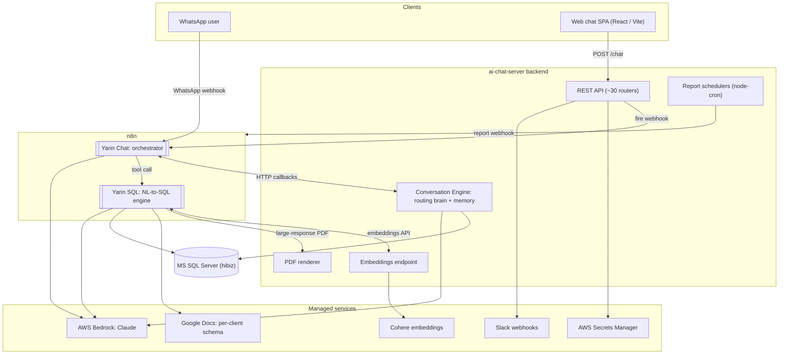
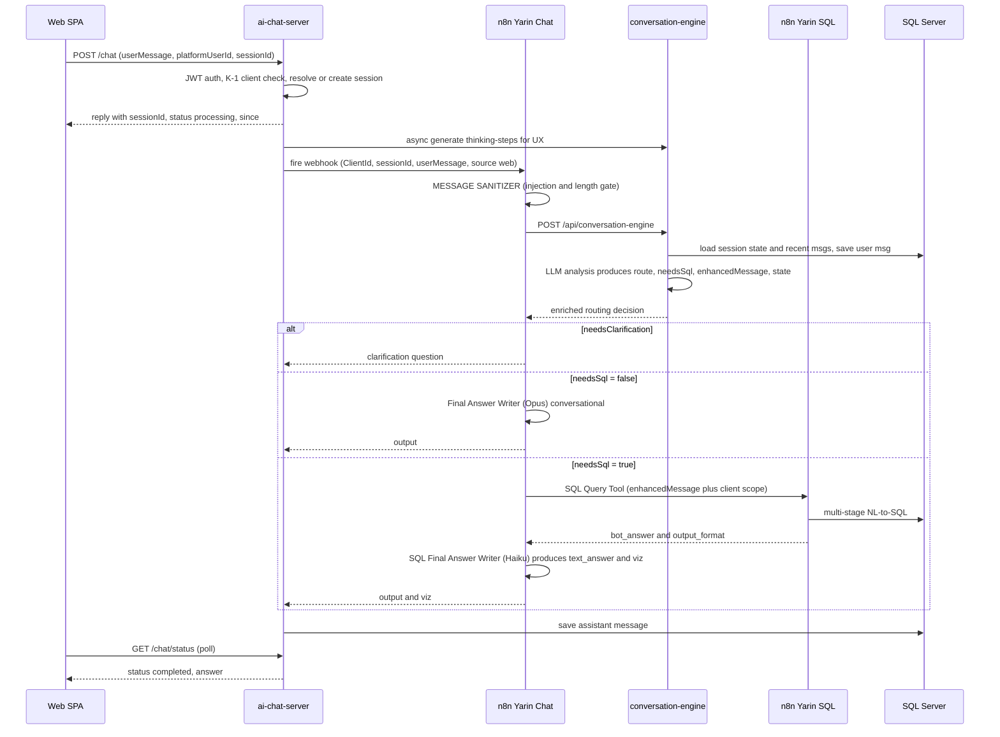

HiBiz lets end users of small and medium businesses ask questions in plain language (mostly Hebrew, some English) over **WhatsApp** or a **web chat**, and get answers grounded in their own business database — as text and, when useful, charts, tables, KPI cards, or PDF reports. This page is the map: read it to understand which runtime owns which responsibility and how a single question flows through the system before diving into any one component.

## What HiBiz is and the problem it solves

The core problem is turning a natural-language business question into a **safe, tenant-scoped SQL answer** without exposing the database to the user or letting one tenant see another's data. HiBiz solves this by splitting the work across specialized runtimes: an LLM decides *what the user wants*, a multi-stage pipeline turns the intent into SQL, and a stateful backend keeps conversation memory and enforces tenant ownership.

The system is composed of **two cooperating runtimes** plus a SQL Server database and a set of managed AI/cloud services:

| Component | Role |
|---|---|
| **`ai-chat-server`** (backend) | Stateful backend: conversation memory & session state, the LLM **routing decision**, embeddings, PDF rendering, web auth + polling, report scheduling, admin tooling. Node.js / Express 5. |
| **n8n workflows** | AI orchestration: intake, injection defense, routing, the multi-stage NL→SQL pipeline, and answer/visualization formatting. Two workflows: **Yarin Chat** (orchestrator) and **Yarin SQL** (data engine). |
| **MS SQL Server** (`hibiz`) | Holds both the tenants' business data and the app's own state (sessions, messages, embeddings cache, config). |
| **Lambdas** | ~20 standalone jobs syncing external POS / payment / delivery systems into the DB. |

## How the system fits together

The runtimes communicate over HTTP webhooks and callbacks; the database is the shared substrate. The diagram below shows the major components and the direction of data flow.

### The technology stack at a glance

- **Backend:** Node.js, Express 5, `mssql`, `axios`, JWT + OTP auth, Helmet / CORS / rate-limiting, `node-cron`.
- **Frontend:** React 18 + Vite SPA (same repo, built to `dist/`), Chart.js for visualizations. `npm start` = `vite build && node server.js`.
- **AI:** AWS Bedrock (Claude **Opus 4.6**, **Sonnet 4.5**, **Haiku 4.5** via inference profiles), Cohere multilingual embeddings.
- **Infra:** AWS Secrets Manager (prod config from secret `hibiz/production`, region `us-east-1`), PM2 (app `ai-chat`).
- **Orchestration:** n8n (`n8n.hibiz.dev`).

## The end-to-end request lifecycle (web chat)

A web question is **fire-and-forget plus polling**: the backend accepts the message, returns immediately with `status:"processing"`, fires the orchestration off asynchronously, and the browser polls for the answer. The WhatsApp path skips the polling and enters Yarin Chat directly, replying over the WhatsApp API.

The key decision point is the **Conversation Engine's routing output**: the LLM decides whether the turn needs clarification, can be answered conversationally, or requires SQL. Only the SQL branch invokes the Yarin SQL data engine. While the browser waits, the backend serves dynamic "thinking steps" purely for UX.

## Multi-tenancy: one `ClientId` per tenant, isolated in depth

Every tenant is a `ClientId`; a tenant has stores (`StoreId`) and platform users (`PlatformUserId`), and access is store-scoped per user via `dbo.PlatformUserStores`. Tenant context is supplied to the LLMs from two sources:

- **Domain descriptions** — the `BUSINESS_CONTEXT` map in `routes/conversationEngine.js` (short, for the routing / conversational LLM).
- **Full schema + business rules** — per-client **Google Docs** (mapped in Yarin SQL's `Choose Docs Prompt` node), exported to large `prompts/*.md` files.

<Warning>
Tenant isolation is enforced in depth, not at a single boundary: the backend runs a `ClientId` ownership check and the workflow validates store access. A change to one layer does not relax the others.
</Warning>

## Key design decisions and trade-offs

- **Orchestration lives in n8n, state lives in the backend.** The two n8n workflows own the AI pipeline (sanitize → route → NL→SQL → format), while `ai-chat-server` owns everything stateful (sessions, memory, the routing *decision* it exposes at `/api/conversation-engine`). This keeps prompt/pipeline changes out of a code deploy, at the cost of a distributed flow spanning HTTP webhooks and callbacks.
- **Web is asynchronous, WhatsApp is synchronous.** The web path decouples request from answer with polling so a slow multi-stage SQL pipeline never blocks the HTTP response; WhatsApp, already async by nature, replies through its own API.
- **Isolated LLM clients per purpose.** Bedrock access is deliberately split into separate modules so their responsibilities never bleed together: `bedrockClient.js` is plain text-in/text-out **reserved for the Conversation Engine**, while embeddings use their own credentials in `embeddingsClient.js` (Cohere `cohere.embed-multilingual-v3` via Bedrock, batched at 96 texts per call).
- **Schema knowledge from per-client Google Docs.** The NL→SQL engine is grounded by per-client Google-Doc schema prompts, exported to large `prompts/*.md` files — its single source of schema truth.
- **Secrets before app.** The process boots `server.js` → `loadSecrets()` → `index.js`, so production config from `hibiz/production` is loaded before the Express app (with its ~30 routers, static SPA/site, schedulers, and DB pre-warm) initializes.

## Where it lives in the code

Start with these entry points to go deeper:

| Concern | Location |
|---|---|
| System architecture reference | `ai-chat-server/ARCHITECTURE.md` |
| Process boot / secret loading | `ai-chat-server/server.js` → `ai-chat-server/index.js` |
| Security middleware (Helmet CSP, CORS, rate limits) | `ai-chat-server/index.js` |
| Conversation Engine routing + tenant context | `ai-chat-server/routes/conversationEngine.js` |
| Conversation Engine LLM client | `ai-chat-server/services/llm/bedrockClient.js` |
| Embeddings (Cohere via Bedrock) | `ai-chat-server/services/llm/embeddingsClient.js` |

<Note>
The `index.js` middleware stack encodes several defense-in-depth defaults worth knowing before you touch request handling: a strict Helmet **Content-Security-Policy** with hashed inline scripts, an allow-list **CORS** policy (localhost, `*.hibiz.dev`, `*.base44.app`, plus `CORS_ORIGINS`), and layered **rate limiters** — 5 logins / 15 min, 10 OTPs / 15 min, 200 API requests / min per IP, and per-`platformUserId` limiters (30 / min) that fall back to IP when the user id is absent to prevent bypass.
</Note>