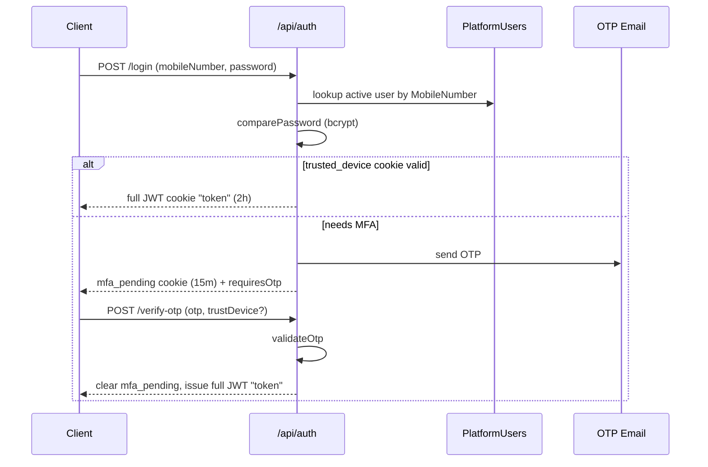

Authentication in the AI chat server is a JWT-in-cookie system with two-factor login and two tiers of access control: whether you are a **Hibiz employee** and which **client** your data belongs to. Reach for this page when you need to understand how a request is authenticated, what lives inside a token, or why a user was denied access to another client's data.

At a high level: a user logs in with a mobile number and password, proves possession of their email with a one-time code, and receives a signed JWT stored as an httpOnly cookie. Every protected route then re-verifies that token through middleware, and permission middleware enforces that regular users only touch their own client's data.

## What this solves

The server serves two audiences from one user table (`dbo.PlatformUsers`): internal Hibiz staff who operate a backoffice, and external client users who see only their own data. The auth system has to:

- **Verify identity** with a password plus an email OTP second factor (MFA).
- **Distinguish employees from clients** so backoffice routes stay internal-only.
- **Isolate client data** so one client can never read another's.
- **Revoke tokens** on logout despite JWTs being stateless.

## The login flow

Login is a two-step, stateful exchange. The first request validates the password and, unless the device is trusted, issues a short-lived "MFA pending" cookie and emails a code. A second request validates that code and swaps the pending cookie for a full session JWT.



**Key steps and their rules:**

| Step | Behavior |
|------|----------|
| Mobile normalization | `login` normalizes Israeli numbers — `0…` → `+972…`, `972…` → `+972…` — before the lookup. |
| Password check | `comparePassword` uses bcrypt against the stored `Password` hash. Invalid mobile or password both return a generic `401 Invalid credentials`. |
| Email required | A user with no `Email` cannot complete MFA and gets a `500` telling them to contact support. |
| Trusted device | If a valid `trusted_device` cookie matches a non-expired row in `dbo.TrustedDevices` (compared by SHA-256 hash), OTP is skipped and a full JWT is issued immediately. |
| OTP issuance | Otherwise `createOtpForUser` generates a code, `sendOtpEmail` delivers it, and an `mfa_pending` cookie is set. The response is `success: false, requiresOtp: true` with a masked email. |
| OTP verify | `verify-otp` reads the `mfa_pending` cookie, requires `decoded.pendingMfa === true`, and calls `validateOtp`. On success it clears the pending cookie and issues the full JWT. |

Every meaningful outcome is written to a structured `[AUTH]` log line via `authLog` (userId, name, clientId, IP from `cf-connecting-ip` or `req.ip`, event, result).

## Tokens and cookies

Tokens are signed JWTs created and verified in `services/auth.js`. There are three kinds, all signed with the same `JWT_SECRET`:

| Token | Created by | Lifetime | Purpose |
|-------|-----------|----------|---------|
| Full session JWT | `generateToken` | `JWT_EXPIRES_IN` (default `2h`) | Authenticated session; stored in the `token` cookie. |
| MFA-pending JWT | `generateTempToken` | `15m` | Carries the user payload plus `pendingMfa: true` between login and OTP verify; stored in `mfa_pending`. |
| Trusted-device token | `generateTrustedDeviceToken` | 7 days | Random 32-byte value; only its SHA-256 hash is stored, so it isn't a JWT. Lets a device skip MFA. |

The full JWT payload carries everything the app needs to identify and scope a user without another DB round-trip:

```js
{ userId, username, role, isHibizUser, clientId, storeId }
```

Cookies are set with `httpOnly: true`, `sameSite: 'strict'`, and `secure` only in production (`NODE_ENV === 'production'`). The session cookie's `maxAge` is 2 hours.

<Warning>
`JWT_SECRET` is mandatory — `services/auth.js` throws `FATAL` at startup if it is unset. All three token types share this one secret, so rotating it invalidates every outstanding token, including trusted-device sessions still in flight.
</Warning>

### Revocation

Because JWTs are stateless, logout adds the token string to an **in-memory blacklist** (`services/tokenBlacklist.js`, a plain `Set`). Both auth middlewares reject any token found in it with `401 Token has been revoked`. The blacklist clears on server restart — acceptable because tokens expire on their own within hours.

## Access control: two middlewares, two questions

Protected routes are guarded by verifying the token and attaching a `req.user` object. Which middleware you mount answers a different question.

<CardGroup cols={2}>
<Card title="authenticateUser">
For regular user routes (employees and clients alike). Verifies the JWT, checks the blacklist, and trusts the token's claims — it builds `req.user` directly from the decoded payload. No database read.
</Card>
<Card title="authMiddleware">
For backoffice routes. Does everything `authenticateUser` does, then **re-reads the database** and requires `IsHibizUser = 1` and `IsActive = 1`. A valid token alone is not enough.
</Card>
</CardGroup>

Both extract the token the same way — the `token` cookie first, then an `Authorization: Bearer …` header — and return `401 No token provided` if neither is present.

The distinction matters for security: `authenticateUser` will happily trust an `isHibizUser: true` claim baked into a token, but backoffice access flows through `authMiddleware`, which confirms the flag against `dbo.PlatformUsers` on every request. A non-Hibiz user reaching a backoffice route is logged and rejected with `403 Access denied. Only Hibiz employees can access the backoffice.` Both the DB flag and the token flag are checked permissively — `=== true || === 1` — to tolerate boolean/int inconsistency.

### Client isolation

`clientPermissionMiddleware` enforces data isolation and runs after an auth middleware has populated `req.user`. It compares the `clientId` in the request (checked in `req.body`, `req.params`, then `req.query`) against the user's own `clientId`:

- **No `clientId` in the request** → allowed through (some endpoints don't need it).
- **Hibiz employee** (`isHibizUser` truthy) → allowed to access **any** `clientId`.
- **Regular user** → allowed only if the requested id equals their own. Both values are `parseInt`-normalized before comparison; a mismatch is logged and returns `403`.

## Design decisions & trade-offs

- **Claims trusted for clients, re-verified for staff.** Reading the DB on every backoffice request costs a query but guarantees a de-provisioned or downgraded employee loses access immediately, rather than when their 2-hour token expires. Regular-user routes skip that cost by trusting the token.
- **In-memory revocation.** A `Set` is simple and fast but is per-process and lost on restart — there is no shared blacklist across instances. Short token lifetimes keep the blast radius small.
- **Trusted devices store only hashes.** The raw device token is never persisted; only its SHA-256 hash is compared, so a database leak can't reconstruct usable device cookies. The login path also caps stored devices (deleting the oldest when at the limit).
- **Generic auth errors.** Login returns the same `Invalid credentials` for unknown mobile and wrong password, avoiding user enumeration.

## Where it lives

| Concern | File |
|---------|------|
| Password hashing, JWT create/verify, token generators | `services/auth.js` |
| Login, OTP verify, trusted-device, logout endpoints | `routes/auth.js` |
| Regular-user auth middleware | `middleware/authenticateUser.js` |
| Backoffice (Hibiz-only) auth middleware | `middleware/authMiddleware.js` |
| Client-scoping middleware | `middleware/clientPermissionMiddleware.js` |
| Revocation blacklist | `services/tokenBlacklist.js` |
| OTP creation/validation/email | `services/otp.js` |

<Note>
`req.user` is the contract every downstream handler relies on. It always contains `userId`, `username`, `role`, `isHibizUser`, and `clientId`; routes behind `authenticateUser` additionally get `storeId` from the token payload.
</Note>