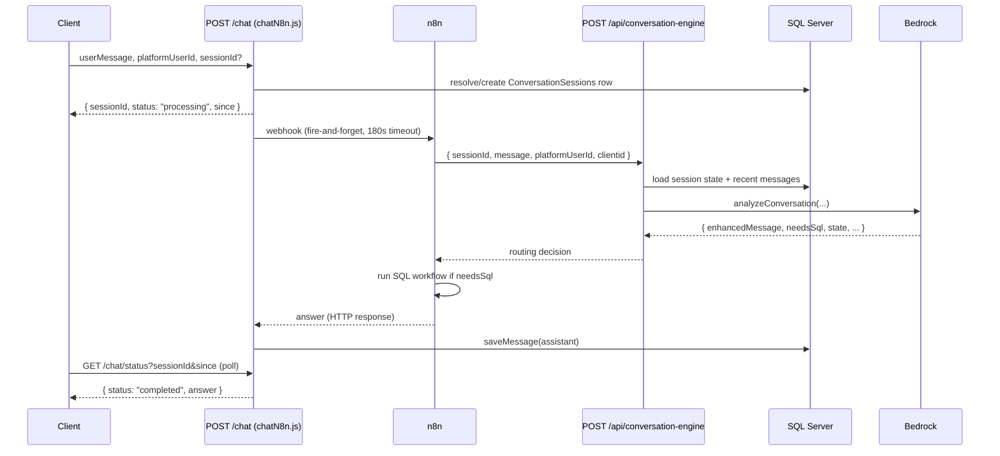

The Chat & Conversation Engine is the subsystem that turns a user's raw message into a stateful, multi-turn conversation — persisting every message, tracking extracted context across turns, and running an LLM "intelligence layer" that decides whether a message needs a database query and enriches it with the conversation's history. Reach for this page when you need to understand how a chat message enters the system, how session state survives between turns, and how the n8n workflow and the conversation engine cooperate.

It spans two cooperating pieces: an **async chat API** (`routes/chatN8n.js`) that clients talk to, and the **conversation intelligence engine** (`services/conversationEngine.js`, exposed to n8n via `routes/conversationEngine.js`) that manages memory, state, and LLM analysis. A third route (`routes/chatSessions.js`) reads history back for the UI.

## What problem it solves

A single user message is rarely self-contained. "And last week?" only makes sense against the previous turn. This subsystem exists to:

- **Persist conversations** as durable sessions and messages so history can be replayed and reasoned over.
- **Carry context forward** — extracted state (metric, time range, filters) accumulates across turns rather than being re-derived each time.
- **Route intelligently** — an LLM decides whether a message needs SQL, or whether a required parameter (like a time range) is missing and the user must be asked to clarify.
- **Stay responsive** — chat requests return immediately and the answer is fetched by polling, so a 3-minute analytics query never blocks the client.

## How it works end to end

The web client fires a message and gets back a `sessionId` and a `processing` status immediately. The heavy work — the n8n workflow, which itself calls back into the conversation engine — runs in the background, and the client polls for the answer.

The key structural decision is that **`POST /chat` never waits for the answer**. It kicks off the n8n webhook with `axios.post(...).then(...)`, and the `.then` handler saves the assistant reply to the database so the polling endpoint can find it later. The client learns the answer through `GET /chat/status`, not through the original response.

### The request path (`POST /chat`)

The handler runs a fixed sequence before firing the webhook:

1. **Authenticate** — reads a JWT from the `token` cookie or an `Authorization: Bearer` header; `verifyToken` must succeed.
2. **Validate** — `userMessage` and `platformUserId` are required; `platformUserId` must parse to an integer.
3. **Authorize** — a non-admin (`decoded.isHibizUser` is not `1`/`true`) may only send as their own `userId`; sending on behalf of another user returns `403`.
4. **Look up the target user** — fetches `ClientId` and `MobileNumber` from `dbo.PlatformUsers` where `IsActive = 1`.
5. **Resolve the session** — if the client passed a `sessionId`, it continues that conversation; if not, a **new** `ConversationSessions` row is always created (a page refresh starts a fresh chat).
6. **Generate thinking steps** — `generateThinkingSteps` runs fire-and-forget and stashes context-aware waiting-UX text in `thinkingStepsStore`, keyed by session, in the same process that serves `/chat/status`.
7. **Forward to n8n** — posts the payload to `N8N_CHAT_WEBHOOK_URL`, then returns `{ sessionId, status: "processing", since }`.

<Note>
The web path has **no time-based session logic**: a missing `sessionId` always means "new conversation." Time-window session reuse (the WhatsApp path) lives elsewhere in the engine's `getOrCreateSession`.
</Note>

### The background handler and error hygiene

When n8n's HTTP response arrives, the background `.then` callback normalizes it before persisting:

- The answer text is taken from `rawData.output` (falling back to `text_answer`, then a default).
- **n8n internal errors are never shown to the user.** `isN8nError` detects both the legacy array form `[{ response: "There was an error..." }]` and a plain `"There was an error..."` string, and replaces it with a friendly Hebrew message.
- **PDF results take priority** — if `pdfResultStore` has an entry for the session (set by the large-response PDF path), that URL becomes the answer.
- **Visualizations** are wrapped: when n8n returns a `viz` object (and there's no PDF and no error), the answer is serialized as `{ __viz__: true, type: "n8n", text, viz }`.

The normalized answer is written with `saveMessage(sessionId, platformUserId, 'assistant', answer)`. All background failures are logged as non-fatal — they never crash the request that already returned.

## The intelligence layer (`analyzeConversation`)

The conversation engine's core is the LLM analysis that n8n calls at `POST /api/conversation-engine` **before** any SQL logic. It receives `{ sessionId, message, platformUserId, clientid }` and returns a routing contract:

| Field | Meaning |
|-------|---------|
| `enhancedMessage` | The user's message rewritten as a standalone, context-resolved business query. |
| `needsSql` | **The only field that controls execution.** Always an explicit boolean, never `undefined`. |
| `route` | Informational only — logging, analytics, and UI hints. |
| `state` | The updated conversation state (extracted context) persisted for the next turn. |

Before analysis, the route enforces **K-1 cross-client protection**: it looks up the caller's `ClientId` in `dbo.PlatformUsers` and rejects (`403`) if it disagrees with the claimed `clientid`. Users not found in the table (legacy/test) are logged and allowed through.

The engine then loads or creates the session, atomically reads-and-clears any pending clarification (`UPDATE ... OUTPUT DELETED`, safe under concurrency), fetches the **last 5 messages**, and persists the incoming user message — the fetch and save run in parallel because they're independent. All of that context is handed to `analyzeConversation`, which calls Bedrock (`callBedrock`) with the `ANALYSIS_SYSTEM_PROMPT`.

### Routing rules that matter

The system prompt encodes a few decisions worth knowing, because they shape every answer:

- **SQL is the default mode.** When in doubt, `needsSql = true`. It's set `false` only for clearly conversational messages (greetings, thanks, identity questions) or questions entirely outside the business's scope.
- **"Today" is never a default time range.** If a query needs a time window and the user named none — in this message, the state, the summary, or recent history — the engine sets `needsClarification = true` and asks, rather than silently assuming today. This clarification rule takes absolute priority over the "when in doubt, run SQL" rule.
- **Clarification answers resume the original question.** When a `<pending_clarification>` block is present and the new message answers it, the engine merges the answer into the saved `partialState` and rebuilds `enhancedMessage` from the original question — now complete.

### Per-client business context

Routing quality depends on knowing what each business does. `BUSINESS_CONTEXT` maps a client id (as a string) to a prose description of that business's domains — e.g. `'1'` is the 9to5 eyewear chain, `'3'` is MFL Sliding Doors, `'12'` is Fattal Hotels. An unknown client id falls back to a generic "commercial business" description. This context is injected into the analysis prompt so the LLM can judge whether a message is answerable from that business's data.

## Sessions and state: the storage model

Conversations live in two SQL Server tables, both scoped by `PlatformUserId`:

| Table | Holds | Notable columns |
|-------|-------|-----------------|
| `dbo.ConversationSessions` | One row per conversation | `SessionId` (`NEWID()`), `State` (JSON), `Summary`, `MessageCount`, `Source` (`'web'` / `'whatsapp'`), `CreatedAt`, `UpdatedAt` |
| `dbo.ConversationMessages` | One row per turn | `SessionId`, `PlatformUserId`, `Role` (`user` / `assistant`), `Message`, `CreatedAt` |

`State` is the accumulating context object (data scope, metric, time range, filters). The engine merges new extraction into it with `deepMergeState` and `sanitizeState`, and maintains a running `Summary` via `updateSummary` so long conversations don't have to replay every message.

A **date-context cache** (`getDateContext`) precomputes ranges like "last week" and "this month" once per calendar day per locale (`he` → Asia/Jerusalem, `en` → America/New_York), so the LLM can resolve time expressions the user actually mentions — but, per the prompt, never uses them as defaults.

### Reading history back (`chatSessions.js`)

The UI reads conversations through two authenticated endpoints (both behind `authenticateUser`, both enforcing the same admin-or-self rule):

- `GET /api/chat-sessions?platformUserId=N` — lists sessions for a user, aggregated from `ConversationMessages`: `SessionId`, `StartedAt`, `LastAt`, and a `Preview` (the first user message), ordered by most-recent activity.
- `GET /api/chat-sessions/:sessionId/messages?platformUserId=N` — returns that session's `Role`/`Message`/`CreatedAt` rows in chronological order.

## Worked example: a follow-up that needs no clarification

1. Turn 1 — user asks "How many sales did we have last week?" The engine extracts `state = { metric: sales, time_context: last_week }`, sets `needsSql = true`, and n8n runs the query.
2. Turn 2 — user says "And by branch?" `POST /chat` reuses the same `sessionId`, so the engine loads the saved `state`. The message is a refinement: `time_context` is already set, so **no clarification is needed** — the engine carries the week forward, produces an `enhancedMessage` like "How many sales per branch last week?", and again returns `needsSql = true`.
3. The client, meanwhile, has been polling `GET /chat/status?sessionId=…&since=…` and receives `{ status: "completed", answer }` once the background handler has saved the assistant reply.

## Where it lives in the code

| File | Responsibility |
|------|----------------|
| `ai-chat-server/routes/chatN8n.js` | Async chat API — `POST /chat` (fire-and-forget) and `GET /chat/status` (polling); n8n error/PDF/viz normalization. |
| `ai-chat-server/routes/conversationEngine.js` | `POST /api/conversation-engine` — n8n's pre-SQL entry point; K-1 client validation, session load, pending-clarification handling. |
| `ai-chat-server/services/conversationEngine.js` | The engine itself — session/message persistence, state merge, summaries, date-context cache, `analyzeConversation`, `generateThinkingSteps`, `callBedrock`. |
| `ai-chat-server/routes/chatSessions.js` | Read-side history API for the UI. |

Related stores — `pdfResultStore`, `thinkingStepsStore` — are in-memory, per-process helpers; note that `generateThinkingSteps` is invoked from the same process that serves `/chat/status` precisely so the store stays reachable regardless of which instance n8n calls back into.