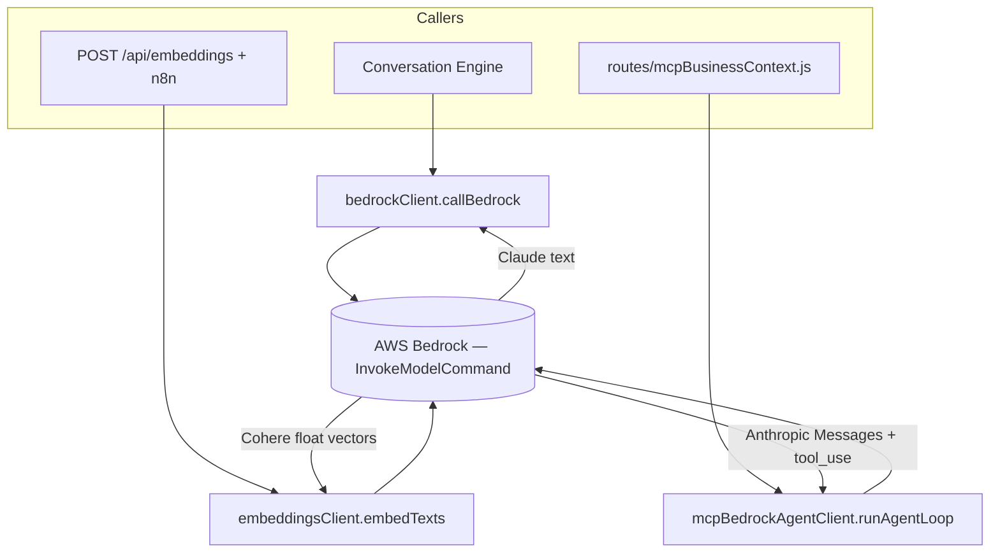

The `ai-chat-server` runs every AI feature through **AWS Bedrock**. Reach for this page when you need to understand how the server calls Claude for chat, how it produces multilingual embeddings for Value Matching, and how its Bedrock agent loop lets an LLM call MCP tools. Everything flows through the `@aws-sdk/client-bedrock-runtime` `InvokeModelCommand` — there are no other model providers in this layer.

## What this is and the problem it solves

The server needs three different LLM behaviors, and it keeps them in three separate modules on purpose. Mixing them — for example, letting the chat client grow tool-use logic — is explicitly discouraged in the code comments. Each module is a self-contained Bedrock client with its own credentials, startup validation, and response shape.

| Module | Model | Purpose | Consumers |
|--------|-------|---------|-----------|
| `services/llm/bedrockClient.js` | Claude 3.5 Sonnet (default) | Plain text-in / text-out for the Conversation Engine | Conversation Engine only |
| `services/llm/embeddingsClient.js` | `cohere.embed-multilingual-v3` | Multilingual embeddings for Value Matching | `POST /api/embeddings`, `scripts/fill-embeddings-cache.cjs` |
| `services/llm/mcpBedrockAgentClient.js` | Claude 3.5 Sonnet (default) | Tool-use agent loop over MCP tools | `routes/mcpBusinessContext.js` |

<Note>
The isolation is a design rule, not an accident. `bedrockClient.js` says "Do NOT import services/openai.js or any other AI module from here," and `mcpBedrockAgentClient.js` is kept separate specifically so the plain Conversation Engine client stays text-only. Treat each client as a closed unit.
</Note>

## How it works end to end

All three clients construct a `BedrockRuntimeClient` once at module load (a singleton), validate their required environment variables at startup, and `process.exit(1)` if any credential is missing. They then wrap Bedrock's `InvokeModelCommand`, decode the response `Buffer` as UTF-8 JSON, and return a shape tailored to their caller.



### Credentials and configuration

The chat and agent clients share one credential pair; the embeddings client uses its own. All three share a single region variable.

| Env var | Used by | Notes |
|---------|---------|-------|
| `AWS_BEDROCK_ACCESS_KEY_ID` / `AWS_BEDROCK_SECRET_ACCESS_KEY` | Conversation Engine, agent client | Required — server exits if missing |
| `AWS_EMBEDDINGS_ACCESS_KEY_ID` / `AWS_EMBEDDINGS_SECRET_ACCESS_KEY` | Embeddings client | Separate key pair for the embeddings account |
| `AWS_BEDROCK_REGION` | All three | Required everywhere |
| `BEDROCK_MODEL_ID` | Conversation Engine, agent fallback | Defaults to `anthropic.claude-3-5-sonnet-20241022-v2:0` |
| `BEDROCK_AGENT_MODEL_ID` | Agent client | Falls back to `BEDROCK_MODEL_ID`, then the Claude 3.5 Sonnet default |

## The Conversation Engine client

`callBedrock({ systemPrompt, userPrompt })` is the simplest client: one system instruction, one user turn, one string back. It sends the native Anthropic Messages payload (`anthropic_version: 'bedrock-2023-05-31'`) with `max_tokens: 1000` and `temperature: 0` for deterministic output, then returns `decoded.content[0].text.trim()`. If the model returns no text, it throws `Bedrock returned an empty response`. There is no streaming, no tool support, and no conversation history — by design.

## Embeddings for Value Matching

`POST /api/embeddings` computes Cohere multilingual embeddings so callers (notably n8n) can find the closest database values to a user's query term. The route validates its input before doing any work, then delegates to `embedTexts`.

- `texts` must be a non-empty array, else `400`.
- `input_type` must be `search_query` or `search_document`, else `400`. Use `search_query` for the user's term and `search_document` for the stored values you compare against.
- Any client error surfaces as `500` with the error message.

Under the hood, `embedTexts(texts, inputType)` **automatically batches at 96 texts per Bedrock call** (`BATCH_SIZE = 96`), sending `truncate: 'END'` so over-long inputs are trimmed rather than rejected. Cohere returns vectors in the same order as the input, and the function re-pairs them, returning `{ text, embedding }` objects.

```json
// POST /api/embeddings
{ "texts": ["North America", "APAC"], "input_type": "search_document" }

// 200 response
{ "embeddings": [
  { "text": "North America", "embedding": [0.012, -0.044, ...] },
  { "text": "APAC",          "embedding": [0.031,  0.008, ...] }
] }
```

## The MCP Bedrock agent loop

`runAgentLoop` lets an LLM call MCP tools dynamically, driving the standard Anthropic tool-use cycle until the model produces a final answer. It is the engine behind `routes/mcpBusinessContext.js`. Unlike the plain client, it uses `max_tokens: 4096` and accepts Anthropic-format `tools` definitions.

The loop, per iteration:

<Steps>
  <Step title="Invoke Bedrock">
    Send the running `messages` array (plus `systemPrompt` and `tools`) via `invokeBedrock`.
  </Step>
  <Step title="Check the stop reason">
    If `stop_reason !== 'tool_use'`, collect the text blocks and return `{ text, toolCalls, iterations }` — the loop is done.
  </Step>
  <Step title="Execute tool calls">
    For each `tool_use` block, call the injected `callTool(name, input)`. Tool errors are caught and fed back as `{ error: message }` rather than crashing the loop. Results are appended as `tool_result` blocks and the loop continues.
  </Step>
</Steps>

The caller supplies `callTool` — an async `(name, input) => Promise<string>` — so the agent client stays agnostic about *which* MCP tools exist; it only orchestrates the conversation. Every tool call is recorded in `toolCalls` with its name, input, result, and result length, and each step is logged for tracing.

<Warning>
The loop is bounded by `maxIterations` (default 8). If the model never stops requesting tools within that budget, `runAgentLoop` returns `{ text: '', toolCalls, iterations: maxIterations }` — an **empty final answer**. Callers must handle the empty-text case, since it signals the loop exhausted its iterations rather than concluding.
</Warning>

## Key design decisions and trade-offs

- **Three isolated clients over one shared abstraction.** Each behavior (chat, embed, agent) has distinct payloads, models, and even credentials. Keeping them apart prevents the plain chat path from accreting tool-use complexity and lets the embeddings account use its own keys.
- **Fail fast on missing credentials.** Every client validates required env vars at import and exits the process if any are absent, so a misconfigured deployment never starts in a half-working state.
- **Deterministic by default.** `temperature: 0` everywhere favors reproducible, consistent output over creativity — appropriate for value matching, structured chat, and tool selection.
- **Batching hidden from callers.** The embeddings client transparently splits large inputs into 96-item Bedrock calls and reassembles them, so route code passes any-size arrays without worrying about Bedrock limits.

## Where it lives in the code

| Concern | File |
|---------|------|
| Embeddings HTTP route + validation | `ai-chat-server/routes/embeddings.js` |
| Conversation Engine client | `ai-chat-server/services/llm/bedrockClient.js` |
| Cohere embeddings client | `ai-chat-server/services/llm/embeddingsClient.js` |
| MCP tool-use agent loop | `ai-chat-server/services/llm/mcpBedrockAgentClient.js` |
| Agent-loop consumer | `ai-chat-server/routes/mcpBusinessContext.js` |
| Embeddings cache filler script | `ai-chat-server/scripts/fill-embeddings-cache.cjs` |