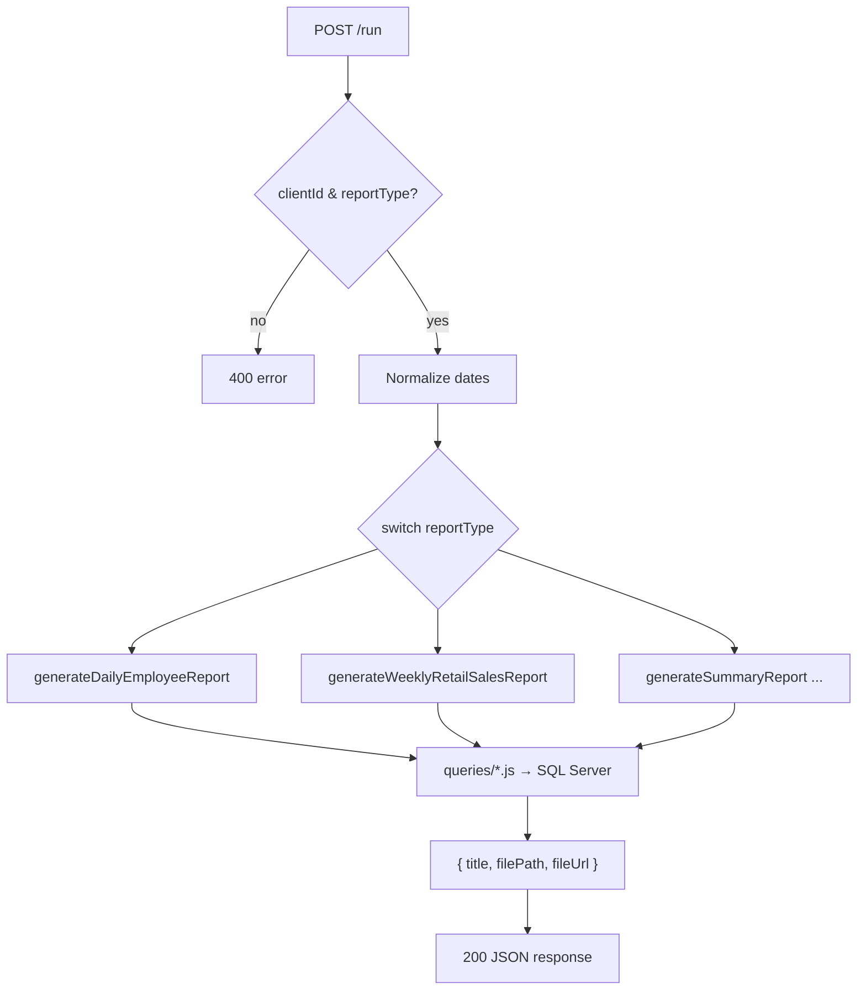

The reporting system turns raw transaction and employee data into ~18 named report types — daily, weekly, and monthly views across retail, restaurant, hospitality, service, and marketing domains — and delivers them either on demand (`POST /run`) or automatically via a cron scheduler. Reach for this page when you need to understand how a report request flows from an HTTP call (or a schedule) down to SQL and back out to a recipient.

The engine lives in the `ai-chat-server` service and has three layers: **route dispatch** (map a `reportType` to a generator), **generators + queries** (fetch and format the data), and the **scheduler** (fire reports automatically on daily/weekly/monthly cadences and hand off delivery to n8n).

## What it is and the problem it solves

Businesses need recurring analytics — "yesterday's employee sales," "last month's service estimates," "this week's retail performance" — segmented by client, store, and domain. Rather than one monolithic report, the system exposes a **catalog of narrow report types**, each backed by its own generator and SQL query set, dispatched by a single `reportType` string.

There are **two parallel implementations**:

| Version | Route file | Services dir | Adds |
|---------|-----------|--------------|------|
| v1 | `routes/reports.js` | `services/reports/` | Original engine |
| v2 | `routes/reportsV2.js` | `services/reportsV2/` | Timezone handling, `dateContext` resolution, `GET /types`, `hotel_performance` |

<Note>
v2 is the timezone-safe evolution of v1, not a replacement — both route files exist and dispatch to separate copies of each generator. New work targets v2; v1 remains for existing callers.
</Note>

## How a request flows end to end

Both routes expose `POST /run`. The handler validates input, normalizes the date range, then uses a `switch (reportType)` to call the matching generator. Every generator returns the same shape, which the route echoes back:

```json
{ "success": true, "title": "...", "filePath": "...", "fileUrl": "..." }
```

**Required fields** are `clientId` and `reportType`; missing either returns `400`. An unknown `reportType` also returns `400 { error: 'unknown reportType' }`, and any thrown error returns `500`.



### Common parameters

| Field | Default | Notes |
|-------|---------|-------|
| `clientId` | — | Required; scopes every query |
| `reportType` | — | Required; selects the generator |
| `storeId` | `null` | Single id, or an array for `franchisee_employee` / `kpi` (normalized to `storeIds`) |
| `startDate` / `endDate` | `null` | Parsed with `new Date(...)` into `normalizedStartDate` / `normalizedEndDate` |
| `period` | `null` | `daily` / `weekly` / `monthly`; used by `summary` |
| `clientName` | `null` | Passed to reports that render a client label |
| `timeZone` *(v2)* | `Asia/Jerusalem` | IANA zone used for server-side date resolution |
| `dateContext` *(v2)* | `null` | `today` / `yesterday` / `last_week` / `last_month` / `custom` |

Not every generator takes every field — the `switch` cases pass only what each report needs. For example, `service_leads_daily` receives `targetDate`, and `service_estimates_monthly` receives `reportDate` (both mapped from `normalizedStartDate`).

### The report catalog

v2 keeps a canonical `REPORT_TYPES` array — the single source of truth that the back-office reads via `GET /types`. Grouped by cadence:

- **Daily** — `daily_employee`, `daily_employee_top`, `daily_cancellations`, `daily_breakfast`, `daily_restaurant`, `service_leads_daily`
- **Weekly** — `weekly_restaurant_employee`, `weekly_retail_sales`, `weekly_retail_employee`
- **Monthly** — `monthly_employee`, `service_estimates_monthly`
- **Cross-period** — `summary`, `marketing`, `weakest_employees`, `franchisee_employee`, `products_report`, `kpi`, `hotel_performance` *(v2 only)*

<Tip>
To add a report: create the generator in both `services/reports/` and `services/reportsV2/` (or just v2), wire a `case` in the corresponding route's `switch`, and append an entry to `REPORT_TYPES` so the back-office picks it up automatically.
</Tip>

## Timezone handling — the key design decision

v2's central problem is date corruption from intermediary systems. When a caller (e.g. n8n) truncates a UTC ISO timestamp to a bare date string like `"2026-04-19"`, JavaScript parses it as UTC midnight — which shifts the Israel (UTC+2/+3) calendar date back by a day. v2 fixes this by resolving dates **server-side** from a semantic `dateContext` plus the schedule's `timeZone`:

```js
if (dateContext && dateContext !== 'custom') {
  const { resolveDateRangeV2 } = require('../services/reportSchedulerUtils');
  const resolved = resolveDateRangeV2(dateContext, timeZone);
  normalizedStartDate = new Date(resolved.startDate);
  normalizedEndDate   = new Date(resolved.endDate);
}
```

`resolveDateRangeV2` (in `reportSchedulerUtils.js`, using `dayjs` with the `utc` and `timezone` plugins) returns full **UTC ISO** boundaries — start-of-day and end-of-day computed in the local zone — instead of the bare `YYYY-MM-DD` strings that v1's `resolveDateRange` produces. For `Asia/Jerusalem`, `yesterday` becomes `2026-04-07T21:00:00.000Z → 2026-04-08T20:59:59.999Z`. If `period` is not supplied, v2 derives it from `dateContext` (`today`/`yesterday`→`daily`, `last_week`→`weekly`, `last_month`→`monthly`).

## The scheduler — automatic firing

`services/reportScheduler.js` runs reports without an HTTP caller. `initReportScheduler()` (called once at startup) registers a **node-cron job that ticks every minute in UTC**; it is a no-op if `N8N_REPORT_WEBHOOK_URL` is unset.

Each tick queries `dbo.ReportSchedules` for active rows whose `NextRunAt` is due (within the last 30 minutes) and processes them with `Promise.allSettled`, so one failing schedule never blocks the others.

<Steps>
<Step title="Compute next run">
`calculateNextRunAt(schedule)` computes the following fire time in the schedule's timezone from `ScheduleType` (`daily` / `weekly` / `monthly`) and `SendMeta` (allowed days of week, or `dayOfMonth` where `-1` means last day of month).
</Step>
<Step title="Atomically claim">
A single conditional `UPDATE` advances `NextRunAt` only if it is still `<= now`. If `rowsAffected` is `0`, another tick already claimed the job and this one skips — this is what prevents double-firing across processes.
</Step>
<Step title="Resolve the date range">
From `FiltersJson.dateContext` (or legacy `range`, default `yesterday`); `custom` uses `resolveCustomRange`, otherwise `resolveDateRangeV2`.
</Step>
<Step title="Expand recipients and fire">
`RecipientsJson` is expanded to one n8n call per recipient. A `pending` row is inserted into `dbo.ReportsLogs` first (so every attempt is recorded), all recipients share one `sendBatchId`, and the webhook is called fire-and-forget with retry (`RETRY_DELAY_MS = 30_000`).
</Step>
</Steps>

The scheduler **does not generate reports itself** — it builds a payload (client, `reportType` from `ReportKey`, date range, recipient, `dateContext`) and posts it to n8n, which orchestrates calling the report route and delivering the result. This decouples scheduling and delivery from generation.

## The query layer

Generators delegate to per-report SQL modules under `services/*/queries/`, which run parameterized queries against SQL Server via `connectToDatabase()`. `summaryQueries.js` is representative and encodes two conventions worth knowing:

- **Israel-time → UTC conversion happens in SQL.** Each query declares `DECLARE @StartDateUTC datetime = DATEADD(hour, -2, @StartDate)` before filtering `dbo.Transactions.SoldAt`, so callers pass local-time bounds and the query shifts them.
- **Discounts and materials are special-cased.** `ItemCode = '7777'` marks discount lines (summed separately), and `PrimaryCategoryName = 'Materials'` (contact lenses) is excluded from product totals. Top-product queries additionally exclude Hebrew vision-related terms.

Worker rankings join `dbo.Transactions` to `dbo.WorkSchedule` on client, store, and matching `WorkDate`, producing "top 3 / bottom 3 workers" by combined product-plus-discount sales.

## Where it lives

| Concern | File |
|---------|------|
| v1 dispatch | `ai-chat-server/routes/reports.js` |
| v2 dispatch + `GET /types` | `ai-chat-server/routes/reportsV2.js` |
| Generators | `ai-chat-server/services/reports/*` and `services/reportsV2/*` |
| SQL per report | `ai-chat-server/services/*/queries/*.js` |
| Scheduler (cron + n8n) | `ai-chat-server/services/reportScheduler.js` |
| Date/schedule helpers | `ai-chat-server/services/reportSchedulerUtils.js` |

Start in the route's `switch` to find a report type's generator, then follow it into the matching `queries/` module to see the exact SQL and business rules for that report.